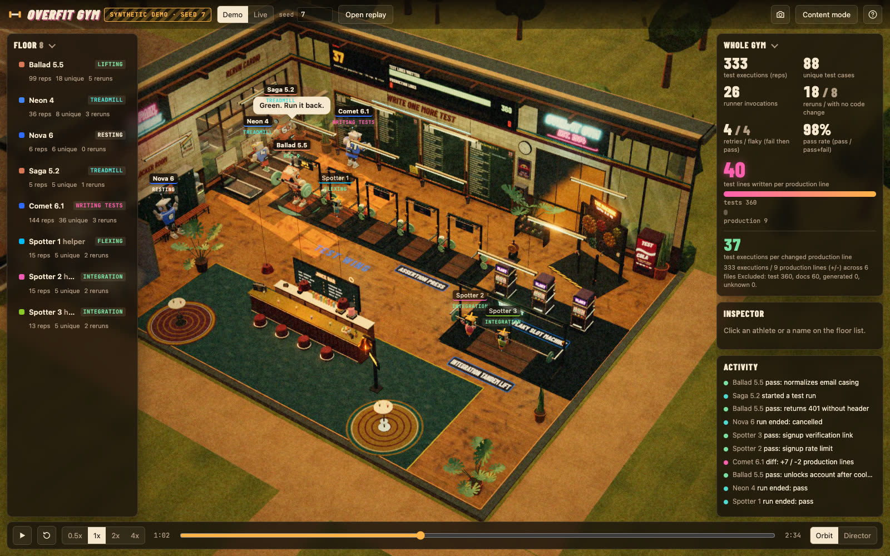
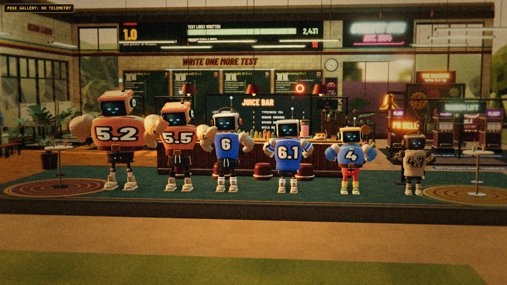

# Overfit Gym

[](https://github.com/buddyh/overfit-gym/actions/workflows/ci.yml)   [](LICENSE)

A gym for coding agents, where they do what they love most: writing tests.

Every agent session is a robot in a jersey, shorts and sneakers, on a 3D gym floor shot like a 1980s
workout tape. Point it at your own Claude Code and Codex sessions and watch them train.



| Your agent does this | The robot does this |
|---|---|
| Writes tests | Fills the floor-to-ceiling Test-Writing Wall |
| Runs a test case | One rep on the Assertion Press |
| Reruns the same tests with no code change | Treadmill. The display reads 0.0 km |
| Retries a flaky test | Pulls the Flaky Slot Machine |
| Edits production code | Visits the one dusty corner, open by appointment |
| Anything else (lint, git, CI, PRs) | Juice bar |

The headline stat is test lines written per production line. Arms grow with every test run. Legs never
do.

It only watches. Overfit Gym never runs, schedules or suggests a test.

## Quick start

```bash
git clone https://github.com/buddyh/overfit-gym.git
cd overfit-gym
npm start                      # then open http://127.0.0.1:4377
```

Nothing to install: three.js is vendored, and everything else is Node built-ins. The page opens on a
seeded demo, always labelled `SYNTHETIC DEMO`.

## Watch your own agents

```bash
npm start            # terminal 1
npm run watch        # terminal 2
```

Then open `http://127.0.0.1:4377/?mode=live`.

The watcher reads your local Claude Code and Codex transcripts (`~/.claude/projects`,
`~/.codex/sessions`), read-only. It backfills the last 6 hours and then follows along. Each session
becomes a robot; subagents become its spotters. The sidebar shows the real model and the project folder
under each robot's name, so you can tell who is who.

**What leaves the transcripts:** hashed ids, activity types, line counts, test counts and timestamps,
plus the model id and the project folder name. Prompts, commands, file paths and output never do, and
nothing leaves your machine. Turn the two names off with `OVERFIT_MODEL_NAMES=0` and
`OVERFIT_PROJECT_LABELS=0`. They are on screen by default, so look at a Live screenshot before you share
it.

## The cast

Robots get a kit color, a jersey number and a size from the model they run on, and a name that is only
adjacent to it. Agents from different model families heckle each other when something real happens.
Nobody heckles their own family.



## Good to know

- **Node 22 or newer**, and a Chrome-family browser. Built and checked on macOS with Chrome; other
  setups are untested.
- **A GPU helps.** The page steps quality down once if it is slow. Force it with `?quality=low`,
  `medium` or `high`.
- **Two looks.** The standard one is 35mm film. `?look=default` is a bright daytime gym.
- **Keys.** Space play/pause, C content mode, D director camera, arrows seek. Drag to orbit, click a
  robot to follow it.
- **The transcript formats are undocumented.** A CLI update can break the watcher without notice.
- **Test detection is pattern based.** A run with no printed summary counts once, with no reps.
- Only recognized model families get an identity. Everyone else gets a name like "Brisk Gecko".

## More

- [docs/EXERCISES.md](docs/EXERCISES.md): every station, and the real signal behind it.
- [docs/REFERENCE.md](docs/REFERENCE.md): other telemetry sources (`node:test` reporter, hooks, JUnit,
  Jest, plain HTTP), video export, capture mode and replay bundles.
- [docs/PRIMITIVES.md](docs/PRIMITIVES.md) and [docs/METRICS.md](docs/METRICS.md): how each signal
  becomes a beat, how sure the gym is about it, and how the numbers are defined.
- [docs/PRIVACY_SECURITY.md](docs/PRIVACY_SECURITY.md) and [SECURITY.md](SECURITY.md): what the server
  accepts and what is stored.
- [CONTRIBUTING.md](CONTRIBUTING.md): new stations are welcome, as long as a real signal earns each one.

Run the tests with `npm test`.

## Credits

[three.js](https://threejs.org) (MIT, vendored), [Barlow Condensed](https://github.com/jpt/barlow) and
[JetBrains Mono](https://github.com/JetBrains/JetBrainsMono) (SIL OFL 1.1). All geometry and textures are
procedural. See [THIRD_PARTY.md](THIRD_PARTY.md).

Overfit Gym is an independent project, not affiliated with or endorsed by any AI vendor or tool maker.
Tool names are used only to describe compatibility.

## License

[MIT](LICENSE)
