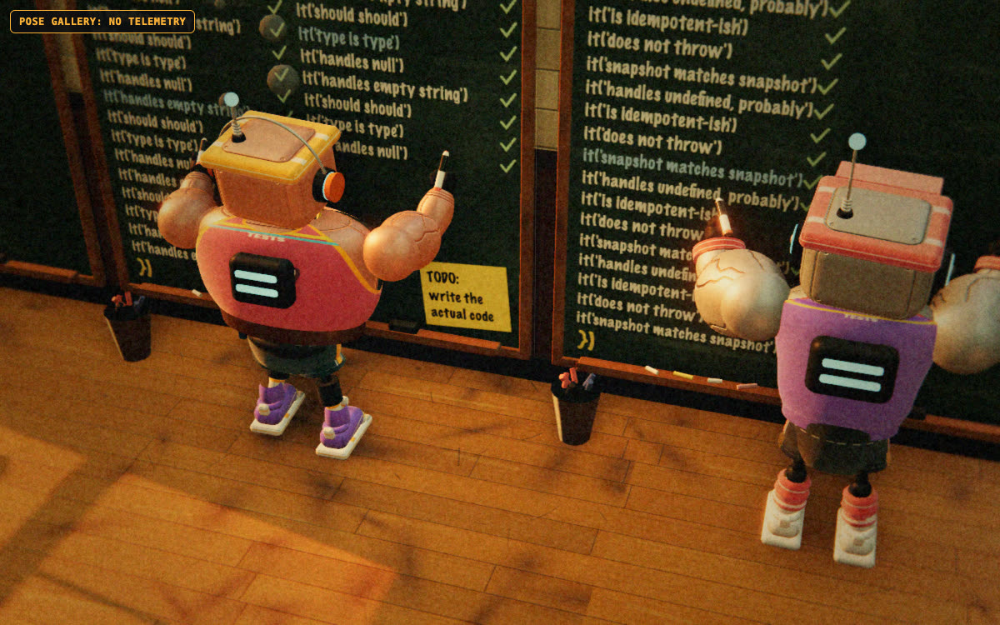
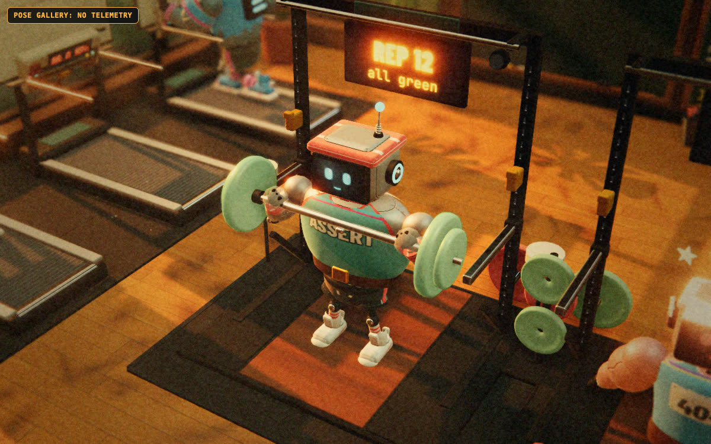
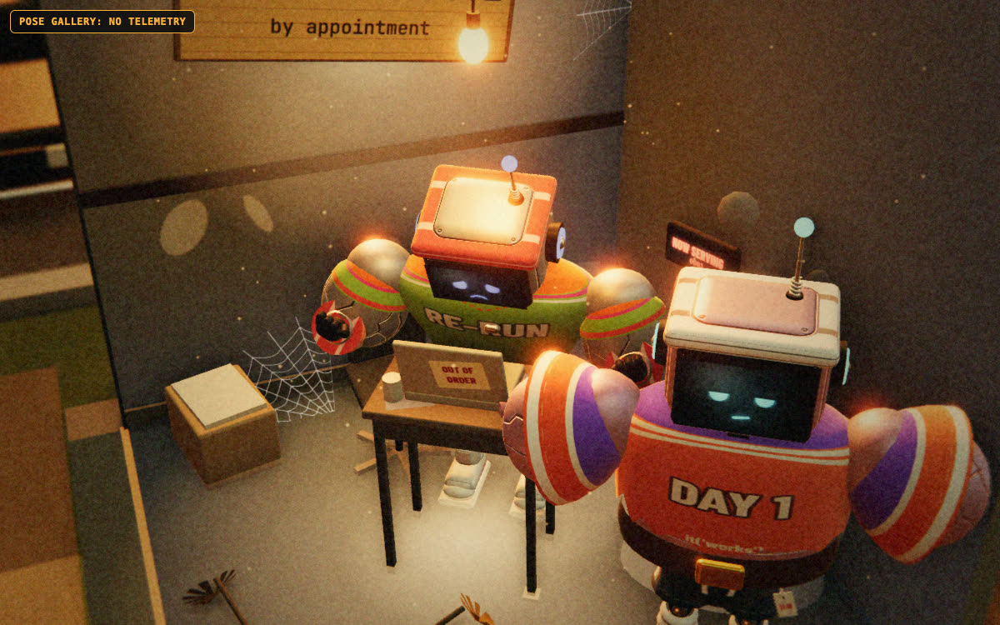

# Exercise catalog: dev puns mapped to real signals

Every station is a pun, but every pun has to be earned by a real signal. "Detect" says how:

- **test**: test-runner events (reporter, JUnit, or transcript).
- **cmd**: a shell command an agent ran, classified by pattern (heuristic, labelled).
- **edit**: an Edit/Write/patch tool call seen in a transcript.
- **tool**: a non-shell tool call (read, search, subagent).
- **derived**: computed from the above.

The athletes are **clankers**: gym robots in shorts, headbands and sneakers. Each agent gets an
archetype deterministically from its id, and the archetype only changes the outfit and default
swagger, never what the agent is shown doing. When the agent's model is known, its identity (see the
README) replaces the kit colors with a numbered jersey and sets the robot's size.

| Archetype | Look |
|---|---|
| Powerbuilder | Tank top, lifting belt, wide chassis, chalked hands |
| Cardio bot | Running singlet, split shorts, visor, neon sneakers |
| Yogi | Long sleeves, leggings, mat strapped to the back |
| CrossFit bot | Compression shirt, knee sleeves, high socks |
| Rookie | Oversized tee, tags still on the shorts |

## The floor today: a test gym with a production-code closet

The joke is how much agents write and run tests, so the floor is built around that. Everything that
isn't testing has been squeezed out.

| Zone | Station | Activity id | Real signal |
|---|---|---|---|
| **Test wing** (about 60% of the floor) | Test-Writing Wall: floor-to-ceiling whiteboards filling up with `it('should should')` | `write-tests` | Edit/Write/patch calls on test files |
| | Assertion Press: one rep per test case | `bench` | test results, or counts from a runner summary |
| | Whiteboard Treadmill: 0.0 km | `treadmill` | rerun of the same target with no edit between |
| | Flaky Slot Machine | `wobble` | retries, fail then pass |
| | Integration Tandem Lift | `coordinated` | integration/e2e test names (heuristic) |
| | The Machine: lifts 0.5 kg | `machine` | test churn 8x production, or a diff spread thin (heuristic) |
| **Production code** (one dim corner, "by appointment") | an old laptop, a 1 kg dumbbell, cobwebs | `edit` | Edit/Write/patch calls on production files |
| **Juice bar** | everything else (lint, build, git, CI, PRs, installs, search, reads); the chip names the activity, and the PR bell rings on merge | all other ids | shell commands and tools |
| **Locker room** | resting | `idle` | nothing happening |

The headline metric is **test lines written per production line**. Both counts come from the same diff
or edit snapshots (see docs/METRICS.md), shown as two bars on the HUD and on the wall billboard.

Stills from the pose gallery (`/gallery.html?kind=write-tests&clean=1`, `kind=bench`, `kind=edit`),
which renders each station with fake view models and no telemetry.

The rest of this document is the full catalog of dev puns that the classifier recognizes. Only the
stations in the table above are built. Every other activity is shown at the juice bar, with the activity
named on the agent's chip and a few of them on the menu board, so the **Visual** column below describes
the pun, not a model in the scene.

## Stations (catalog)

| Station (pun) | Activity id | Real signal | Detect | Visual |
|---|---|---|---|---|
| **Assertion Press** | `bench` | one test case executed | test | press with green plates (pass) or red plates that crash (fail) |
| **Whiteboard Treadmill** | `treadmill` | rerun of the same target with no code change | derived | robot runs on a treadmill stuck at 0.0 km, with a whiteboard in front |
| **Test-Writing Treadmill** | `treadmill` + `edit-test` | test files edited between reruns | edit + derived | scribbles on the whiteboard while running; the whiteboard shows the test lines written |
| **Flaky Slot Machine** | `wobble` | retry, fail then pass | test | robot pulls a slot machine lever; the reels land on red-red-green |
| **Integration Tandem Lift** | `coordinated` | integration or e2e named tests | test (heuristic name) | long bar shared with spotters |
| **Spotter Drones / Spotters** | `spotting` | subagent spawned | tool | helper robots hover around the parent |
| **The Machine** | `machine` | diff spread thin, or test churn 8x production | derived (heuristic) | contraption lifting a 0.5 kg dumbbell |
| **Lint Pulldown** | `lint` | eslint, ruff, biome, swiftlint, golangci-lint, clippy, prettier --check, stylelint | cmd | cable lat pulldown; plates labelled with lint rule counts |
| **Lat Pull Request** | `pr` | `gh pr create`, `gh pr edit`, `gh pr ready` | cmd | wide-grip pulldown with a "PR #" banner coming down |
| **Personal Record Bell** | `merge` | `gh pr merge`, a merge to main | cmd | rings the PR bell: a personal record and a pull request at once |
| **Git Push-ups** | `push` | `git push` (`--force` gets a one-arm push-up) | cmd | push-ups on a mat |
| **Git Pull-ups** | `pull` | `git pull`, `git fetch` | cmd | pull-up bar |
| **Commit Crunches** | `commit` | `git commit` (atomic commits mean many small crunches) | cmd | crunches on a mat with a counter |
| **Diff Dips** | `diff` | `git diff`, `git show`, `git log -p` | cmd | parallel-bar dips |
| **Grep Grip Trainer** | `grep` | `rg`, `grep`, `ag`, `find`, `Select-String`, `findstr`, Grep/Glob tools | cmd, tool | squeezing hand grippers |
| **Type-Check Yoga** | `typecheck` | `tsc`, `mypy`, `pyright`, `cargo check`, `go vet` | cmd | stretch poses on a mat |
| **Build Bulk** | `build` | `npm run build`, `vite build`, `cargo build`, `go build`, `xcodebuild build`, `swift build` | cmd | protein shaker plus heavy farmer's carry |
| **CI Spin Class** | `ci` | `gh run watch`, `gh pr checks`, `gh run view`; polling CI | cmd | spin bike facing a CI status board |
| **Dependency Burpees** | `install` | `npm install`, `pip install`, `brew install`, `cargo add` | cmd | burpees |
| **Format Foam Roller** | `format` | prettier --write, black, gofmt, rustfmt, swift-format | cmd | foam rolling on the floor |
| **Benchmark Press** | `benchmark` | `hyperfine`, `cargo bench`, `go test -bench`, `npm run bench` | cmd | a literal bench press with a stopwatch |
| **Coverage Weigh-in** | `coverage` | `--coverage`, `c8`, `nyc`, `coverage run`, `go test -cover` | cmd | steps on a scale that shows a percentage |
| **Squash Squats** | `rebase` | `git rebase`, `git commit --amend`, squash | cmd | squats |
| **Rollback Rowing** | `revert` | `git revert`, `git reset`, `git restore`, `git checkout --` | cmd | rowing machine: pulling backwards |
| **Docker Box Jumps** | `docker` | `docker build`, `docker run`, `docker compose` | cmd | box jumps onto a shipping-container box |
| **Edit Station** | `edit` | Edit/Write/apply_patch on production files | edit | typing on a laptop strapped to a dumbbell rack |
| **Reading Rack** | `read` | Read tool, Skill tool, `cat`, `sed -n`, `head`, `Get-Content`; Codex `view_image` | tool, cmd | reading a fitness magazine titled after the file type |
| **Mental Reps** | `think` | a thinking block (Claude) or a reasoning item (Codex). Kept off the activity feed: it precedes nearly every step | tool | eyes closed, visualizing the lift |
| **Front Desk Phone** | `connector` | an MCP tool call to a connector (mail, chat, issue trackers, ...). Host plumbing (`ccd_*`, terminal, `node_repl`) is skipped. The connector's name is never sent | tool | on the phone at the front desk |
| **Bike + TV** | `browse` | browser automation (MCP servers named browser, chrome, playwright, puppeteer), WebFetch, WebSearch; Codex `web__*` and `web_search_call` | tool | stationary bike facing a TV |
| **Workout Clipboard** | `plan` | TodoWrite, task lists, plan mode; Codex `update_plan` | tool | writing on a clipboard |
| **Coach's Whistle** | `coach` | a message a person typed, or an interrupt. Injected context, subagent prompts and Codex reviewer history are excluded. The text is never sent | tool | looks up at the whistle |
| **Sauna** | `wait` | the agent asked the person a question (AskUserQuestion; Codex `request_user_input`) | tool | sweating it out, waiting on the coach |
| **Dropped Weight** | `fumble` | a failed tool call that has no beat of its own (a failed edit, read or connector call) | tool | the weight hits the floor |
| **Protein Shake** | `refuel` | context compaction (Claude `compact_boundary`, Codex `compacted`) | tool | chugging a shaker |
| **Spotter Huddle** | `huddle` | messaging a subagent (SendMessage; Codex `send_message`, `followup_task`) | tool | huddled with the spotters |
| **Locker Room** | `idle` | no activity | derived | sitting on the bench, sipping coolant |

The transcript-tool beats above have no 3D equipment yet: like the other non-test activities they show at
the juice bar, with the activity named on the agent's chip.

On Windows the classifier also reads PowerShell: `pwsh -Command` wrappers, the `&` call operator and
`$x = <command>` assignments are stripped, and a project's own test script (`run-tests.ps1`,
`./test.sh`, `Invoke-Pester`) counts as a test run.

## Ideas parked (not detectable yet, or not honest yet)

| Pun | Would need |
|---|---|
| Stress-test deadlift (k6, locust, ab) | easy cmd pattern; parked only for station budget |
| Fuzzing HIIT (random intervals) | cmd pattern for `cargo fuzz`, atheris, AFL |
| Mutation-testing muscle confusion | cmd pattern for stryker, mutmut, cargo-mutants |
| Snapshot mirror selfies (`-u`, `--update-snapshots`) | cmd pattern; mirror wall prop |
| Sauna for permission prompts (the agent's own questions are now `wait`) | permission-request events (hooks only) |
| Rest timer (rate limited, 429) | parse API errors from transcripts |
| Skipping leg day (no e2e tests in a repo) | repo-level test inventory |
| Battle ropes (`tail -f` logs) | cmd pattern; long-running commands |
| Plank hold (waiting on a long command) | command duration in transcripts |
| Deadline lift (time pressure) | no honest signal |

## Captions (samples, always tied to a real count)

- "Lint Pulldown, set 4. The linter is still unimpressed."
- "Git push-up #9 today. Form check: `--force`. One arm. Brave."
- "Commit crunch 31. Abs of steel, history of granite."
- "New PR! (Pull request. Also a personal record.)"
- "Diff dips: same diff, viewed 6 times. It hasn't changed. Neither has the code."
- "Type-check yoga: 0 errors. Inner peace achieved, briefly."
